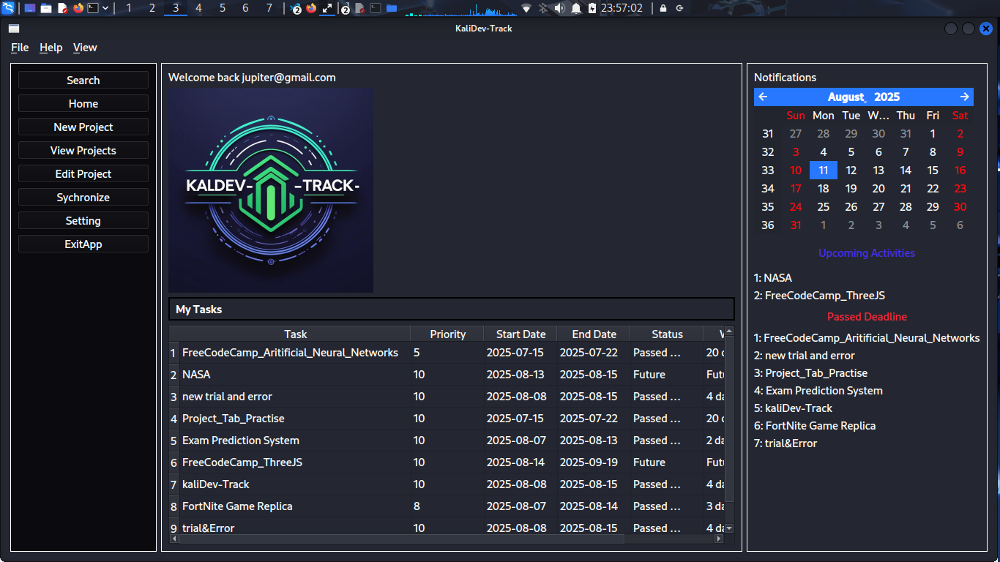

# kALIDEV-TRACK

[](https://wakatime.com/badge/user/ca37100b-7f0f-4ae1-947c-ff595165e688/project/034b45f1-a1e8-420c-9e89-f194d93f4d50)

**kALIDEV-TRACK** is a desktop application built with Python and PySide6 designed to help developers track the progress of their software projects and tasks. It provides a clean, user-friendly interface to manage, view, and organize your workflows efficiently without relying on a web browser.



## Features

- **Full CRUD Capabilities:** Create, view, update, and delete projects.
- **Phases & Subtasks:** Break down projects into manageable phases and track individual subtasks.
- **Deadline Tracking:** Monitor project start/end dates and visualize upcoming or overdue activities.
- **Portable Storage:** Data is stored locally in JSON files for easy backup and portability.
- **Safe Deletion:** Move projects to the system recycle bin safely using `Send2Trash`.
- **AI Assistant:** Built in AI Assistant chat, requires ollama to be set locally on device.

## Upcoming Features

- [ ] Analytics Dashboard: View project completion rates (on time, delayed, or faster) with data visualization.
- [ ] Email Notifications: Automated emails to the user when project deadlines approach.
- [ ] OS Notifications: Native desktop notifications for near-deadline projects.

---

## Installation

### Option 1: Install the Debian Package (Recommended for Kali/Debian Users)

If you are on a Debian-based system (like Kali Linux or Ubuntu), you can install the pre-built `.deb` package directly from the [GitHub Releases](https://github.com/alsongard/KALIDEV-TRACK/releases) page.

```bash
# Navigate to the folder where you downloaded the .deb file
sudo dpkg -i kalidev-package.deb

# If there are missing dependencies, run:
sudo apt install -f
```

Once installed, you can launch **kALIDEV-TRACK** from your application menu or by typing `kalidev-track` in the terminal.

### Option 2: Build and Run from Source (For Developers)

1. **Clone the repository:**
   ```bash
   git clone https://github.com/alsongard/KALIDEV-TRACK.git
   cd KALIDEV-TRACK
   ```

2. **Set up a virtual environment:**
   ```bash
   # Create the environment
   python3 -m venv .venv
   
   # Activate the environment (Linux/macOS)
   source .venv/bin/activate
   
   # Activate the environment (Windows)
   # .venv\Scripts\activate
   ```

3. **Install dependencies:**
   ```bash
   pip install -e ".[dev]"
   ```
   *(Note: Make sure you are using Python 3.10 or higher).*


## Usage

### Running from Source
If you installed via source (Option 2), you can run the application with:
```bash
python app/main.py
```

### Running the Installed App
If you installed via `.deb` (Option 1), simply run:
```bash
kalidev-track
```

---

## Project Structure

```text
.
├── .venv/                          # Virtual environment (ignored by Git)
├── app/
│   ├── __init__.py
│   ├── main.py
│   ├── global.qss                  # Application styling
│   ├── database/
│   │   ├── __init__.py
│   │   ├── db_manager.py
│   │   ├── project_repository.py
│   │   └── project_types.py
│   ├── models/
│   │   ├── __init__.py
│   │   ├── home_table_model.py
│   │   └── tasks_table_model.py
│   ├── resources/
│   │   ├── icons/                  # Application icons (.png, .svg)
│   │   └── images/
│   │       └── docs/               # Documentation screenshots
│   ├── utils/
│   │   ├── __init__.py
│   │   ├── button_delegate.py
│   │   ├── config_manager.py
│   │   └── file_operations.py
│   └── views/
│       ├── __init__.py
│       ├── ask_ai_view.py
│       ├── backup_data_view.py
│       ├── create_tasks_widget.py
│       ├── docs_view.py
│       ├── edit_project_view.py
│       ├── form_window.py
│       ├── home_view.py
│       ├── list_all_project_view.py
│       ├── projects_page_view.py
│       ├── settings_view.py
│       ├── synchronize_list_projects.py
│       ├── tasks_view.py
│       └── view_projects.py
├── kalidev-package/                # PyInstaller/Linux packaging structure
│   ├── DEBIAN/
│   │   └── control                 # Debian package metadata
│   └── usr/
│       ├── bin/
│       │   └── kalidev-track       # Launcher script
│       └── share/
│           ├── applications/
│           │   └── kalidev-track.desktop
│           └── icons/
│               └── kalidev-track.jpg
├── .gitignore
├── .gitattributes
├── DESIGN.md                       # Architecture and design docs
├── README.md
├── pyproject.toml                  # Python project configuration
├── requirements.txt                # (Legacy) dependencies
└── package.json                    # (Optional) Node configs if using frontend tooling
```

---

## Contributing

Contributions are what make the open-source community such an amazing place to learn, inspire, and create. Any contributions you make are **greatly appreciated**.

1. Fork the Project
2. Create your Feature Branch (`git checkout -b feat/AmazingFeature`)
3. Commit your Changes (`git commit -m 'feat: add some AmazingFeature'`)
4. Push to the Branch (`git push origin feat/AmazingFeature`)
5. Open a Pull Request

**Project Philosophy:** This project is meant for humans. Please do not submit raw, AI-generated code without thoroughly reviewing, understanding, and adapting it to the project's architecture. 

---

## License

Distributed under the **GPLv2 License**. See `LICENSE` for more information.