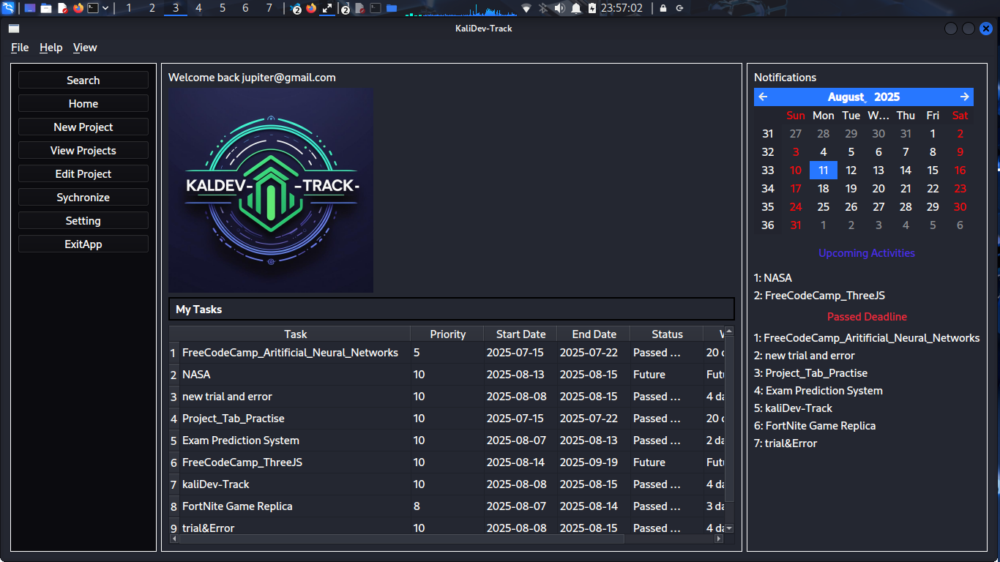

# kALIDEV-TRACK

[](https://wakatime.com/badge/user/ca37100b-7f0f-4ae1-947c-ff595165e688/project/034b45f1-a1e8-420c-9e89-f194d93f4d50)

## Description

**kALIDEV-TRACK** is a desktop application for tracking the progress of your software projects and tasks. Built with PySide6, it provides a user-friendly interface to manage, view, and organize your projects efficiently.



---

## Features

- Create, view, update, and delete projects
- Create, Edit, Delete and View project phases and it's subtasks
- Track project deadlines and task statuses
- Visualize upcoming and overdue activities
- Data stored in JSON files for easy backup and portability
- Move projects to recycle bin (using `send2trash`)
- Cross-platform support (Linux, Windows, macOS)

---

## Installation

1. **Clone the repository:**
    ```sh
    git clone https://github.com/alsongard/KALIDEV-TRACK
    cd KALIDEV-TRACK
    ```

2. **Install dependencies:**

    - Create a python environment
    ```bash
        mkdir .venv
        cd .venv
        python3 -m venv . 
    ```
    - Install 
    ```sh
    pip install -e ".[dev]"
    ```

    *Typical dependencies:*
    - PySide6
    - send2trash

3. **Setup MongoDB**  
    setup your mongodb url in an env file for backingup data
---

## Usage

Run the main application:

```sh
python app/main.py
```

You can now create and manage your projects and tasks through the GUI.

---

## Project Structure

```
.
├── .venv/                          # Virtual environment (ignored by Git)
├── app/
│   ├── __init__.py
│   ├── main.py
│   ├── global.qss
│   ├── models/
│   │   ├── __init__.py
│   │   ├── home_table_model.py
│   │   └── tasks_table_model.py     
│   ├── resources/
│   │   └── icons/                  # Directory for all application icons
│   ├── utils/
│   │   ├── __init__.py
│   │   ├── button_delegate.py
│   │   └── file_operations.py
│   └── views/
│       ├── __init__.py
│       ├── backup_data_view.py
│       ├── create_tasks_widget.py
│       ├── edit_project_view.py
│       ├── form_window.py
│       ├── home_view.py
│       ├── projects_page_view.py
│       ├── tasks_view.py
│       └── view_projects.py
├── research/
├── .gitignore
├── DESIGN.md
├── README.md
├── package.json
├── package-lock.json
└── requirements.txt
```

---

## Contributing

Pull requests are welcome! For major changes, please open an issue first to discuss what you would like to change.

---

## License

This project is licensed under the GPLv2 License.

---

